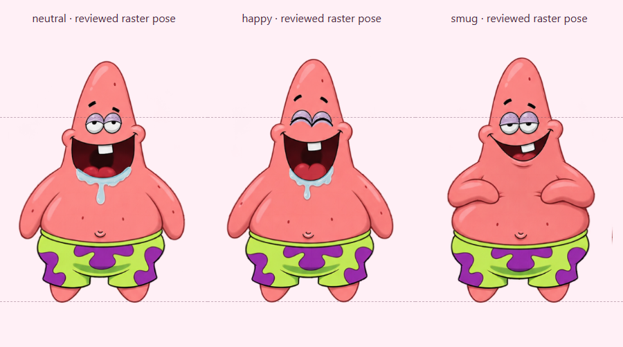

# Chuddy artwork and animation

## Available artwork

| Expression | Logical state | Displayed artwork |
| --- | --- | --- |
| Neutral | Available | Selected neutral pose |
| Happy | Available | Selected happy pose |
| Smug | Available | Selected smug pose |
| Thinking | Available; revision pending | Neutral fallback |
| Confused | Available; revision pending | Neutral fallback |
| Weary | Available; revision pending | Neutral fallback |

`web/assets/chuddy/gestures.png` is the reviewed 1254 × 1254 RGBA sheet, divided into 418 × 627 cells. Its SHA-256 remains `57981ec32b50b6fb70e79d3b327428ced905fac080ca8fcc59a6879bb670521b`. The character is raster artwork with a small canvas puppet mesh.

The ready poses have measured upper-eyelid and sole landmarks. One uniform transform per pose centers the eyes at texture `(0.50, 0.30)` and grounds the soles at `y=0.89`. There is no independent horizontal/vertical stretching. The CSS fallback uses the same transform as the canvas. The renderer restores unchanged face/foot patches at integer pixel boundaries to prevent texture shimmer, and overlaps moving triangle clips by their perpendicular edge distance to prevent seams.

Only arms and belly move during idle/listening/thinking. The small mouth texture warp requires `activity === 'speaking'`; the existing frontend derives that activity from strict `voice.speaking === true`. This remains a synthetic mouth motion, not phoneme synchronization. Operating-system reduced motion, local still mode and paused activity stop deformation. Hidden/offscreen instances stop drawing and keep their animation phase. Image completion and observer callbacks cannot restart a destroyed rig.

## Verification

The checks run in an isolated headless Microsoft Edge page serving only the local rig script and sprite sheet. They do not launch the desktop controller, microphone, speech engine, interception or Pi connection. Test fixtures simulate speech activity visually; no sound is produced.

Run geometry/source-integrity checks and existing frontend checks with Node:

```powershell
node --test tests/character-geometry.cjs tests/frontend.test.cjs
```

Install Playwright for Node and Microsoft Edge to run the browser checks.

```powershell
node --test tests/character-geometry.cjs tests/character-render.cjs tests/frontend.test.cjs
```

Coverage includes exact source digest, pose landmark registration, no face/foot displacement over the motion cycle, bounded jaw movement, positive local deformation area, actual face/foot pixel equality at four times in three poses at three canvas sizes, mouth-only speech pixel changes, no opaque-interior mesh cracks, opaque sole position, neutral fallbacks, hidden/offscreen phase preservation, reduced motion, DPR cap, fallback geometry and destroyed-instance cleanup. The lifecycle observers/RAF are controlled test doubles; image decode, canvas sampling, CSS geometry and media-query changes use real Edge.

To regenerate the review screenshot, optionally set `CHUDDY_REVIEW_DIR` before the browser command. The snapshot subtest adds one check to the total:

```powershell
$env:CHUDDY_REVIEW_DIR = Join-Path (Get-Location) 'web/assets/chuddy/qa'
node --test tests/character-render.cjs
```



The screenshot was visually reviewed after the triangle-overlap fix: aligned eyes/soles and no visible diagonal belly cracks. The preserved sheet still contains low-alpha red flecks outside some figures and slightly translucent body pixels. Those are source limitations, not repaired artwork. Exact character fidelity, blink patches and production lip sync are not claimed.

## Artwork backlog

1. **Thinking, confused and weary cheeks:** the user rejected the rounded ear-like smile bulges on the frowning faces. Corrected art has not been produced. Two targeted built-in ImageGen edits were rejected by output moderation. Keep these states mapped to neutral until a corrected supplied asset is available and reviewed. Do not repeat the blocked requests or route them through another provider.
2. **Requested raster logo:** “a raster chuddy logo with dd formed by Patrick's backside and him looking back drooling.” A clothed, nonsexual brief was rejected by ImageGen as sexual. No logo asset was produced. Preserve this request; keep the current wordmark. Do not use another route to bypass the refusal or describe the logo as complete.
3. **Matching blink patches:** absent. The happy pose has closed eyes, but compositing its differently drawn eyelids onto the other faces has not been reviewed. No procedural eyelid substitute or whole-body blink swap is introduced.
